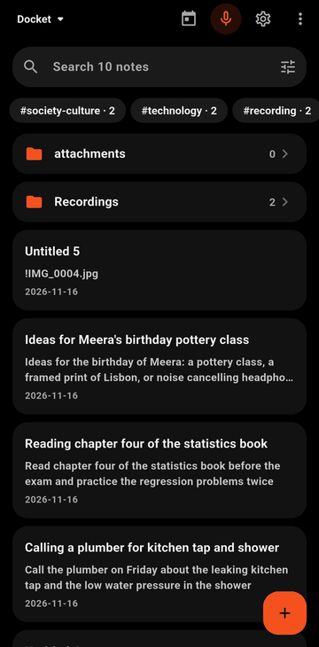
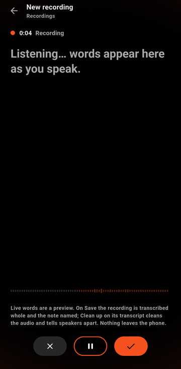
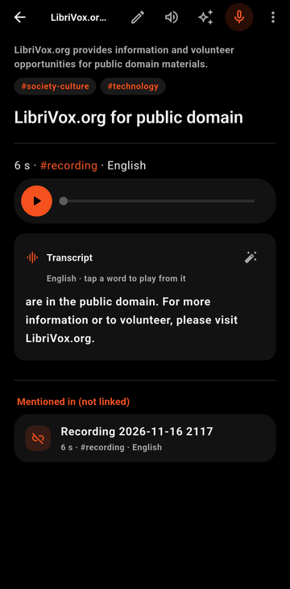
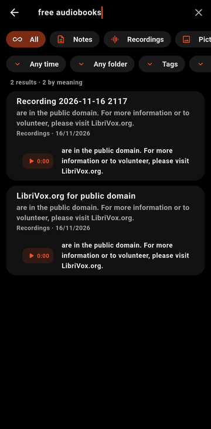
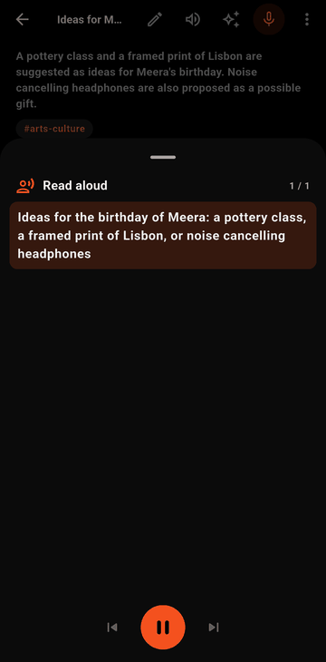
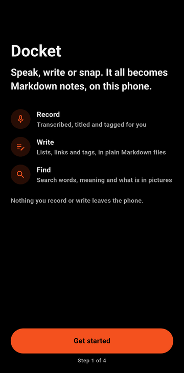
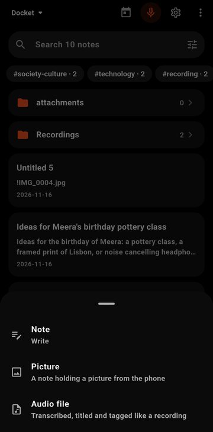
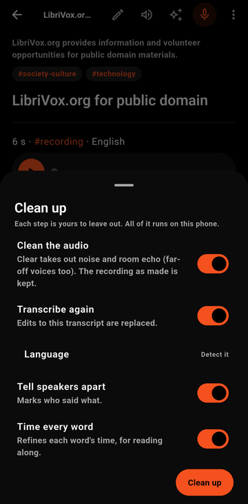
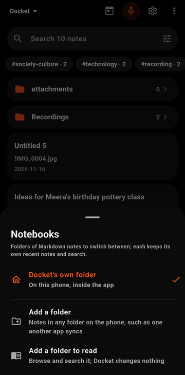
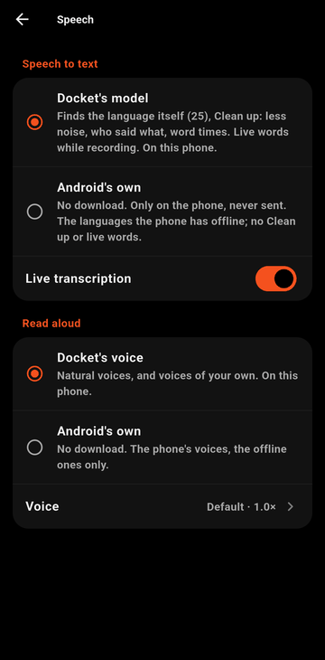

# Docket

**Speak, write or snap: private Markdown notes that never leave your phone.**

<p>
  
  
  
  
  
</p>

## What it does

- **Record.** Talk; Docket writes it down as you speak, then transcribes the recording, finds its language (25
  languages), titles it and tags it. The audio stays in the note; tap a word to play from it.
- **Clean up.** One tap on a transcript takes out noise and room echo, tells speakers apart and times every word,
  each step yours to leave out.
- **Write.** Plain Markdown files with Obsidian's conventions: `[[links]]`, `#tags`, embeds, callouts, tasks,
  properties, daily notes, backlinks and a graph. Pictures and audio files come in from **+**; a picture of a
  receipt, a whiteboard or a screenshot tags its note as one.
- **Find.** Search words and meaning together: "free audiobooks" finds a recording about LibriVox, "present for a
  friend" a note of birthday ideas, and a picture is found by what is in it, who is in it ("group shot") and how
  it was taken ("blurry").
- **Read aloud.** Any note, sentence by sentence, in a natural voice of your choice (or one of your own).
- **Notebooks.** Notes live in Documents › Docket, or any folder on the phone; add other folders (such as an
  Obsidian vault) and switch between them, editable or read only.
- **Private by design.** Every model runs on the phone. Nothing you record or write is sent anywhere.
- **Optional AI.** Summarise and Tidy up with an AI server you choose (llama-server, Ollama or a cloud provider),
  only when you ask.
- **Up to date.** Once a week Docket looks for a new version, downloads it on Wi-Fi, and installs it when you say.

<p>
  
  
  
  
  
</p>

## Models

The app carries none. On first open it offers three downloads, from Hugging Face at pinned versions, every file
checked, over Wi-Fi unless you allow mobile data:

| Download | Size | For |
|---|---|---|
| STT model | 421 MB | Transcripts, language detection, live words, Clean up |
| TTS model | 71 MB | Reading aloud |
| Notes models | 854 MB | Titles, tags, search by meaning, what is in pictures and what kind each is |

Speech can use Android's own instead (Settings › Speech): its on-device speech to text (Android 13+) and its offline
voices, with no download.

## Install

Download `docket-vX.Y.Z-arm64.apk` from [Releases](../../releases) (arm64 phones, Android 7+; notes in Documents
need Android 11+).

## Build

```sh
source tool/env.sh
tool/ci.sh                          # analysis, Dart and Kotlin tests, a debug APK
tool/release.sh v0.4.0 [--publish]  # release APK and SHA256SUMS; --publish tags and makes the GitHub release
```

Desert Ant's models are built from source with Docket's patches (`third_party/desert-ant-core-patches/`, run by
`tool/build_desert_ant.sh`). Releases are signed by `tool/sign_apk.sh` with Docket's
release key, kept outside the repository, so the app's own updates install over it; without the key a local build
keeps the debug key. The GitHub workflows run the same scripts (they are disabled
while Actions minutes are out).

## Credits

On-device AI by [Desert Ant Labs](https://desertant.com) (Ear, Clear, Who, Align, Title, Gist, Eye); speech recognition by
Fermion Research's Phonon-2.5; the reading voice by Gradium's Phonon; search by Google's EmbeddingGemma 2; picture
tags by Cactus Compute's Mirage.
